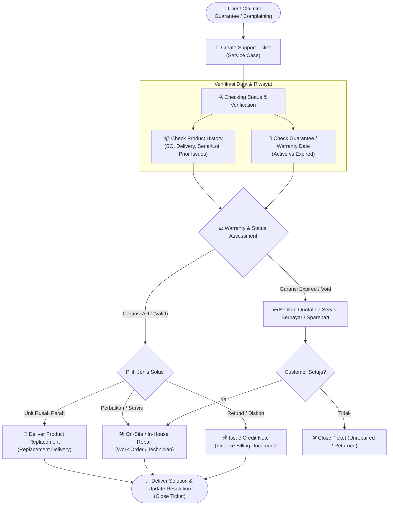
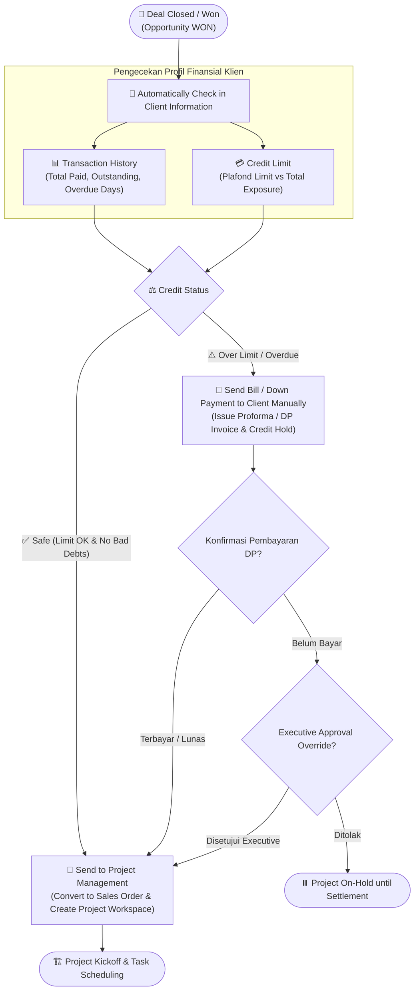
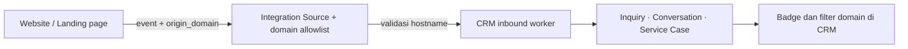

# CRM & Customer Service Workflow Specification

Dokumen ini memetakan flow operasional **Customer Relationship Management (CRM)** dan **Customer Support/Service** pada ERP. Format diagram menggunakan **Mermaid** dan deskripsi terstruktur sehingga mudah disesuaikan (*editable*), dikembangkan, dan diintegrasikan ke backend maupun frontend.

> **Runtime note — 7 September 2026:** flow ini dijalankan melalui backend Express/Prisma dan frontend Next aktif. Endpoint CRM telah masuk audit route menyeluruh; company scope dan derived-record inheritance telah diperketat. Dashboard CRM menggunakan agregasi server dan maksimal enam opportunity preview. Lihat [Current Implementation Status](docs/CURRENT_IMPLEMENTATION_STATUS.md).

> **Pembaruan implementasi — 14 Oktober 2026:** pemeriksaan garansi kini memverifikasi serial number yang tercatat pada pengiriman company dan kontrak garansi aktif; status tiket ditampilkan di CRM dan work order repair dapat dibuat setelah hasil `WARRANTY_ACTIVE`. Pembuatan replacement delivery dan credit note tetap mengikuti workflow Inventory/Finance tersendiri. Credit Hold otomatis dilepas setelah Proforma Invoice terkait dibayar penuh dan terverifikasi. Nilai Proforma saat ini memakai total quotation; aturan nominal DP khusus belum dikonfigurasi. Integrasi webhook, API token portal, dan kontrak event dicatat di [Headless CRM Integration](docs/CRM_HEADLESS_INTEGRATION.md).

> **Pembaruan implementasi — 21 Oktober 2026:** sumber integrasi landing page dapat membatasi hostname domain asal. Event inquiry, pesan, dan tiket menyimpan `origin_domain` untuk ditampilkan serta difilter di CRM. Tab Engagement menyediakan pencatatan feedback dan CSAT untuk Sales Order `FULFILLED`; CSAT saat ini dicatat staf dari hasil survei pelanggan, satu respons per order. Tab Accounts mendukung tambah dan edit profil rekanan, sedangkan Sales Order mengikuti alur quotation accepted atau Deal Won dan pemeriksaan kredit. Detail kontrak integrasi ada di [Headless CRM Integration](docs/CRM_HEADLESS_INTEGRATION.md).


---

## 📑 Daftar Isi
1. [Flow 1: Ticket Support & Warranty / Complaint Management](#1-flow-1-ticket-support--warranty--complaint-management)
2. [Flow 2: Deal Management & Credit Assessment (Won to Execution)](#2-flow-2-deal-management--credit-assessment-won-to-execution)
3. [Flow 3: Domain Asal, Engagement & CSAT](#3-flow-3-domain-asal-engagement--csat)
4. [Mapping Relasi Model ERP](#4-mapping-relasi-model-erp)
5. [Panduan Update & Modifikasi Flow](#5-panduan-update--modifikasi-flow)

---

## 1. Flow 1: Ticket Support & Warranty / Complaint Management

Alur penanganan keluhan pelanggan, klaim garansi produk, perbaikan (*repair*), maupun penggantian unit (*replacement*).

### 1.1 Visual Flow Diagram (Mermaid)



### 1.2 Detail Tahapan & Field Data

| Step | Action / Aktivitas | Data Input / Checks | Output / State | Terkait Model ERP |
|---|---|---|---|---|
| **1** | **Create Support Ticket** | Customer, Contact, Product, Serial Number / Lot, Problem Subject & Description, Priority. | Ticket status: `OPEN`, SLA due date dihitung otomatis. | `service.Case` |
| **2** | **Checking Status** | Lookup riwayat transaksi dan status unit. | Verifikasi kepemilikan dan integritas serial number. | `service.Case`, `sales.Order` |
| **2a** | **Product History** | Riwayat Delivery, riwayat reparasi sebelumnya, catatan log keluhan. | Track record histori produk. | `sales.Delivery`, `inventory.SerialNumber` |
| **2b** | **Product Guarantee Date** | Tanggal serah terima vs masa berlaku garansi kontrak/SLA. | Status: `WARRANTY_ACTIVE` / `WARRANTY_EXPIRED`. | `sales.Contract`, `master_data.Product` |
| **3** | **Deliver Solution** | Keputusan penanganan (Ganti unit, perbaikan, credit note). | Ticket status: `RESOLVED` / `CLOSED`. | `service.Resolution`, `sales.Delivery`, `finance.BillingDocument` |

---

## 2. Flow 2: Deal Management & Credit Assessment (Won to Execution)

Alur otomatisasi ketika Opportunity/Deal berstatus `WON` untuk memeriksa kesehatan finansial & batas kredit klien sebelum dialihkan ke Project Management.

### 2.1 Visual Flow Diagram (Mermaid)



### 2.2 Detail Tahapan & Aturan Keputusan

| Step | Kondisi / Evaluasi | Tindakan Sistem | Output / State | Terkait Model ERP |
|---|---|---|---|---|
| **1** | **Deal Won** | Opportunity stage diubah menjadi `WON`. | Trigger background check / webhook. | `crm.Opportunity` |
| **2** | **Transaction History** | Menghitung rasio pembayaran on-time, total nilai transaksi lampau, dan ada/tidaknya piutang macet. | Skor track record klien (`GOOD` / `RISKY`). | `finance.BillingDocument`, `finance.Payment` |
| **2a** | **Credit Limit** | `Total Piutang Belum Lunas + Nilai Deal Baru` $\le$ `Credit Limit Party`. | Flag: `SAFE` atau `EXCEEDED`. | `master_data.CustomerProfile`, `crm.CreditStatusSnapshot` |
| **3A** | **Credit Status = Safe** | Limit mencukupi, tidak ada tunggakan jatuh tempo. | Konversi ke Sales Order dan handoff ke Project Management. | `sales.Order`, `projects.Project` |
| **3B** | **Credit Status = Over** | Limit terlampaui atau terdapat faktur jatuh tempo. | Terbitkan Proforma Invoice / DP, set status `CREDIT_HOLD`. | `finance.BillingDocument`, `core.WorkflowApproval` |

---

## 3. Flow 3: Domain Asal, Engagement & CSAT

### 3.1 Atribusi domain untuk data inbound

Integration Source menyimpan allowlist hostname yang diizinkan untuk event dari website. Server mengirim `data.origin_domain` pada event `inquiry.submitted`, `message.received`, `ticket.created`, atau `feedback.submitted`. Marka menormalisasi dan memvalidasi hostname terhadap source yang menandatangani event; domain yang tidak diizinkan ditolak. Domain disimpan pada Inquiry, Conversation, Service Case, atau Feedback agar staf dapat melihat badge dan memfilter record web berdasarkan sumbernya. Event tanpa domain tetap diterima dan tampil tanpa badge; jika allowlist kosong, jangan sertakan `origin_domain`.



Masukkan hostname saja (misalnya `promo.arsalynk.com`) dalam allowlist; payload boleh mengirim hostname atau URL dasar tanpa path/port. Jangan mempercayai nilai hostname yang dikirim langsung dari browser; tentukan nilainya di server website.

### 3.2 Feedback dan survei CSAT

Tab Engagement memisahkan ulasan umum (`crm_feedback`) dari CSAT yang terkait transaksi (`crm_survey_response` dan `crm_survey_answer`). Feedback yang dicatat staf internal tetap memilih customer. Integrasi eksternal dapat menerima reviewer tanpa akun dengan `reviewer_name`, rating 1–5, dan catatan; `customer_code` opsional. Nama hanya ditautkan otomatis jika cocok persis dengan tepat satu customer aktif, sedangkan nama ambigu/tidak dikenal tetap tersimpan tanpa tautan customer. CSAT dipilih dari Sales Order berstatus `FULFILLED`, memiliki rating 1–5 serta komentar opsional, dan dibatasi satu respons per order. Respons ditautkan ke customer dari Sales Order dan dapat menampilkan domain asal jika tersedia.

Pada implementasi saat ini, tombol **Catat CSAT Transaksi** merupakan input staf berdasarkan jawaban pelanggan. Sistem belum mengirim undangan atau menyediakan form publik untuk pelanggan; untuk itu diperlukan kanal pengiriman, tautan survei bertoken, dan kontrol autentikasi/anti-spam tersendiri.

### 3.3 Tampilan CRM dan aturan pembuatan transaksi

- **Accounts** menampilkan daftar rekanan dengan aksi tambah dan edit. Perubahan nama, kode, tipe, atau status dilakukan dari form edit; data kontak tambahan dikelola sesuai sumber master-data yang tersedia.
- **Contracts & Orders** adalah tampilan hasil transaksi dan petunjuk alur. Quotation diterima dapat dikonversi menjadi Sales Order; Deal Won berjalan melalui pemeriksaan kredit. Tab ini tidak membuat Sales Order/kontrak manual yang melewati validasi tersebut.
- **Incoming Inquiry, Inbox, dan Tickets** menyediakan filter domain saat data memiliki `origin_domain`; rekaman lama tanpa domain tetap tersedia lewat pilihan semua domain.

---

## 4. Mapping Relasi Model ERP

```text
[CRM Lead] ──> [CRM Opportunity] ──> [Sales Quotation] ──> [Sales Order] ──> [Project Workspace]
                        │                                          │
                        ▼ (Cek Kredit)                             ▼ (Klaim Servis)
             [Customer Profile / Snapshot]                  [Service Case / Ticket]
                        │                                          │
                        ▼                                          ▼
             [Finance Billing / DP]                         [Service Resolution]
                                                            ├── Replacement Delivery
                                                            └── Credit Note
```

---

## 5. Panduan Update & Modifikasi Flow

Untuk menyesuaikan flow sesuai kebutuhan bisnis di masa mendatang:

1. **Menambah Cabang Logika / Decision**:
   - Tambahkan node bertanda `{ "Pertanyaan Kondisi" }` pada diagram Mermaid.
   - Buat cabang panah `-- "Pilihan A" -->` dan `-- "Pilihan B" -->`.
2. **Menambah Step Baru**:
   - Gunakan format kotak `STEP_NAME["📝 Nama Langkah"]`.
3. **Sinkronisasi ke Codebase**:
   - Logika Service Ticket berada di `backend/apps/service/`.
   - Logika Deal & Credit Check berada di `backend/apps/crm/` dan `backend/apps/finance/`.
   - UI interaktif prototype dapat dilihat pada folder `uji_prototype/`.
